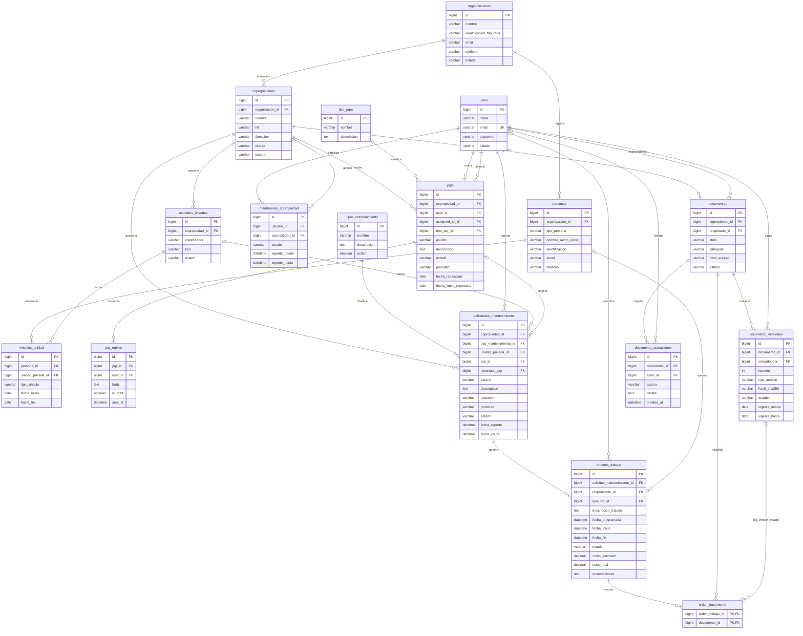

# MER Resuelve ERP

## Figura para el informe

La [imagen resumida para Word](mer-resumen-informe.png) muestra las relaciones principales de organización y comunidad, atención de PQRS y mantenimiento con evidencia documental. A un ancho de 15,5 cm conserva las proporciones y cabe en una página vertical. El esquema físico completo puede citarse como anexo.

## Esquema físico implementado

[Abrir el diagrama completo como imagen ampliable](mer-fisico.svg)

El [MER físico editable en Mermaid](mer-fisico.mmd) reúne las 50 tablas resultantes de aplicar las [migraciones del proyecto](../../database/migrations/) en una base SQLite temporal. Incluye las 467 columnas y las 81 claves foráneas declaradas. En Visual Studio Code, abre el archivo y ejecuta `Mermaid: Preview Diagram` para ver el diagrama.

Cada línea lleva los nombres de las columnas de la tabla hija que forman la clave foránea. Por ejemplo, `mantenimientos.pqr_id` es opcional y permite asociar varios mantenimientos a una PQRS. Las claves compuestas se representan con una sola línea. Las asociaciones polimórficas, como el destinatario de una notificación, se reconocen por sus columnas de tipo e identificador. Los tipos de columna corresponden a SQLite. El [modelo de datos](modelo-de-datos.md) detalla reglas de integridad y particularidades de MySQL.

## Modelo conceptual del negocio

El diagrama siguiente resume la administración de copropiedades y sus procesos. También se puede consultar como [imagen](diagrama_mer.png) o abrir su [fuente editable en Mermaid](erDiagram.mmd).

> **Implementación física (Sprint 19).** La integración operativa usa las
> tablas `mantenimientos` (con `pqr_id` para la PQRS de origen,
> `idempotency_key` única para la idempotencia y los campos de resultado
> público/interno con trazabilidad) y el puente
> `mantenimiento_documento_evidencia`, que fija la versión exacta de la
> evidencia (`documento_version_id`). Equivalen al agregado conceptual
> `solicitudes_mantenimiento`/`ordenes_trabajo`/`orden_documento` del diagrama;
> el detalle completo está en [modelo-de-datos.md](modelo-de-datos.md).

## Lectura del diagrama

- **PK:** clave primaria.
- **FK:** clave foránea.
- **UK:** valor único.
- **Uno a muchos:** un registro puede relacionarse con varios registros de otra entidad.
- Las relaciones opcionales permiten que no exista un registro asociado.

## Reglas principales

- Una organización administra varias copropiedades.
- Los usuarios participan en copropiedades mediante membresías.
- Las personas se vinculan con unidades privadas como propietarios, residentes u otros tipos de vínculo.
- Una PQRS puede originar varias solicitudes de mantenimiento; también pueden registrarse solicitudes sin una PQRS previa.
- Una solicitud de mantenimiento puede generar varias órdenes de trabajo.
- El responsable de una orden coordina la actividad; el ejecutor puede ser una persona natural o jurídica.
- Las solicitudes pueden corresponder a una unidad privada o a una zona común identificada mediante su ubicación.
- Los documentos conservan versiones e historial de actuaciones.
- Una orden puede tener varios documentos de soporte y un documento puede respaldar varias órdenes.
- Los vínculos entre registros deben respetar la organización y copropiedad correspondientes.

## Alcance del modelo

Se muestran las entidades y atributos principales para explicar los procesos del negocio. Se omiten tablas auxiliares de permisos, notificaciones, auditoría técnica y otros detalles de infraestructura.
